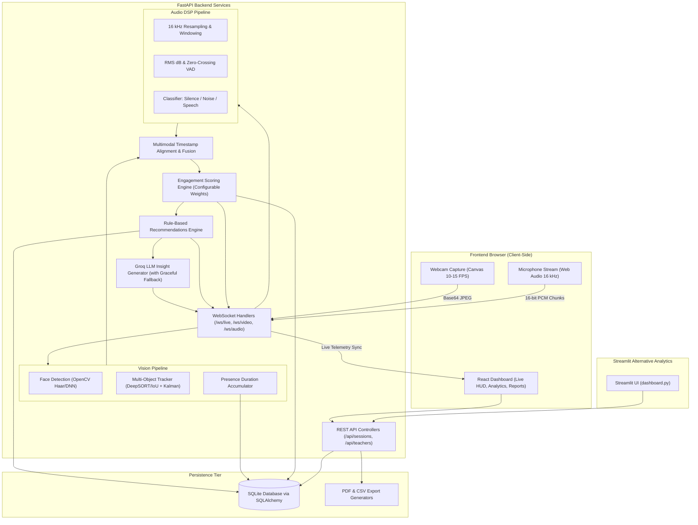
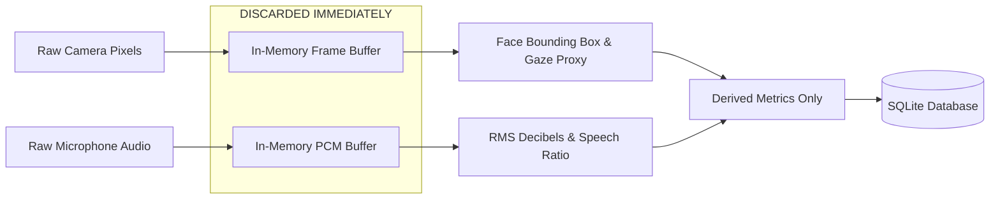

# EduSense AI — System Architecture & Data Flow

## 1. High-Level Architecture Overview

EduSense AI is designed as a three-tier, privacy-preserving multimodal intelligence platform:
1. **Frontend Presentation Tier:** React (Vite) Single Page Application capturing webcam and audio locally in browser, rendering live detection bounding boxes, engagement HUDs, and reflective summaries.
2. **Backend Processing Tier:** FastAPI + Uvicorn server running computer vision (OpenCV face detection, DeepSORT multi-object tracking, presence accumulation), audio DSP (16 kHz normalization, RMS decibels, zero-crossing rate VAD), multimodal fusion, and the rule-based reasoning engine with optional Groq LLM fallback.
3. **Storage & Analytics Tier:** SQLite with SQLAlchemy ORM storing derived non-punitive metrics, attendance logs, and pedagogical alert histories. Alternate Streamlit dashboard for administrative analytics.

---

## 2. Multimodal Signal Fusion & Engagement Formula

The platform aligns visual attention and acoustic environment into unified temporal snapshots:

$$E = \frac{w_{\text{att}} \cdot A + w_{\text{mov}} \cdot M + w_{\text{aud}} \cdot S_{\text{audio}}}{w_{\text{att}} + w_{\text{mov}} + w_{\text{aud}}}$$

Where:
- $w_{\text{att}} = 0.45$: Weight for frontal gaze and visual attentiveness
- $w_{\text{mov}} = 0.20$: Weight for natural, non-restless body stability
- $w_{\text{aud}} = 0.35$: Weight for acoustic context (active speech participation vs. noise vs. silence)

All parameters are transparently defined in `backend/core/config.py` and editable via `.env` without modifying code.

---

## 3. Privacy-First Boundary (NFR-1)

Raw audio waveforms and raw video frames exist only momentarily in volatile RAM buffers during analysis and are immediately discarded. No video or audio files are ever written to disk.
